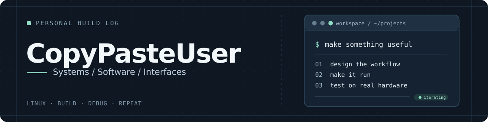
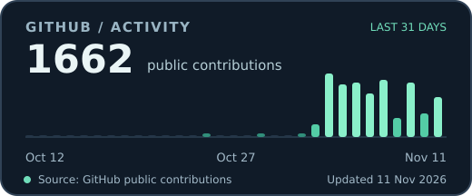

  

  **Linux-first software · Desktop interfaces · Homelab engineering**

  I build tools I'd actually want to run: practical, customizable and light on resources.

## What I'm building

### 🍚 [RiceBowl](https://github.com/CopyPasteUser/Ricebowl)
Seven OS-inspired Linux desktop styles, currently on XFCE/X11. An opt-in **labwc/Wayland desktop preview** now includes a native Rust panel, desktop shortcuts, RiceSpice settings, RicePop's actionable Mako-backed notification inbox, volume/brightness OSD, native accessibility support and an offline recipe/visual-testing CLI for AI-assisted ricing; XFCE/X11 remains the default.

**Python · GTK · Linux · Wayland roadmap**

### 📁 [RiceField](https://github.com/CopyPasteUser/Ricefield)
A Rust file manager with seven customizable shells, tabs, split view, search, archive support and guarded local operations. **1.0.0-rc.20** includes the XP Luna shell, guarded WebDAV single-file uploads, folder/tab drag-and-drop and asynchronous large-folder sorting. Recovery durability has improved; stable 1.0 still requires remaining safety checks and physical hardware acceptance.

**Rust · egui · Linux**

### 📊 [Taskotto](https://github.com/CopyPasteUser/Taskotto)
A working Rust process manager and system monitor with seven OS-inspired interfaces, live metrics and customizable **RicePack** designs. **1.0.0-rc.56** adds data-defined client screens and diagnostic layouts; window decorations are handled by the desktop. Recent work reduced sampling overhead; native GUI and resource-use acceptance remain open.

**Rust · Linux · RiceBowl ecosystem**

### 🎬 [DubSync Studio](https://github.com/CopyPasteUser/dubsync-studio)
Tools for aligning multilingual video and audio, with scene matching and visual review.

**Python · PySide6 · FFmpeg**

### 🖧 Satella OS (private)
My self-hosted homelab control project for Linux services, administration and automation.

## GitHub activity

  

Recent public contributions · <a href="https://github.com/CopyPasteUser?tab=overview">View the GitHub contribution calendar</a>

## A little about me

- **Interests:** Linux desktops, Rust, Python, system integration, networking, self-hosting and media tools.
- **Approach:** make it work, test it, make it efficient, then refine the experience.
- **Hardware:** real desktops, laptops and a small homelab — not just screenshots or mockups.
- **Process:** some work is AI-assisted; I review the behavior, integrate the pieces and validate the result.

<em>Build it. Break it. Understand it. Make it better.</em>

